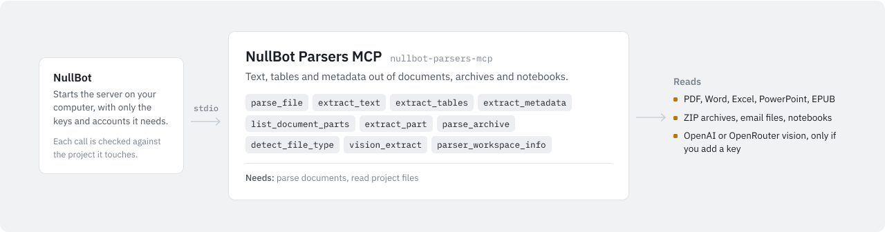

# NullBot Parsers MCP

<picture>
  <source media="(prefers-color-scheme: dark)" srcset="assets/nullbot-parsers-mcp-dark.svg">
  
</picture>

`nullbot-parsers-mcp` turns documents and other non-code files in a workspace folder into text, metadata, tables, and entry lists that an agent can read, and can send scanned pages and images to OpenAI or OpenRouter for OCR. It is a standalone Go MCP server built on [`github.com/Bradthebrad/tinychain/mcp`](https://github.com/Bradthebrad/tinychain). It works with NullBot and with any MCP client, and uses stdio by default.

## Tools

All paths are relative to the workspace folder.

| Tool | What it does |
| --- | --- |
| `parser_workspace_info` | Shows the workspace, the path rule, `max_bytes`, the supported formats, and which vision keys and settings are present. |
| `detect_file_type` | Reports the type, MIME hint, parser, size, and part types of a file, based on its extension. For an unknown extension, the MIME hint comes from the file's first bytes. |
| `parse_file` | Parses a file into structured JSON: metadata plus text, rows, slides, chapters, cells, or entries, depending on the format. |
| `extract_text` | Returns the plain text of a file. For formats without a single text field, returns the parsed JSON as text. |
| `extract_metadata` | Returns the type information and, where the format has it, its metadata (OOXML core properties, PDF info fields, notebook metadata) without the content. |
| `list_document_parts` | Lists the entries inside ZIP-based files (DOCX, PPTX, XLSX, EPUB, OpenDocument, ZIP) and TAR or TGZ archives. For other formats it returns the part types it knows, such as `pages`. `max_items` defaults to 200. |
| `extract_part` | Returns one entry from a ZIP-based file by its internal path, such as `word/document.xml`. XML is reduced to text and HTML tags are removed. |
| `extract_tables` | Returns rows from CSV, TSV, XLSX, and XLSM files. For CSV and TSV, `max_rows` defaults to 100; XLSX returns up to 100 rows per sheet. |
| `parse_archive` | Lists the entries of ZIP, TAR, and TGZ archives and of ZIP-based documents. A plain `.gz` file returns only its gzip header. `max_entries` defaults to 500. |
| `vision_extract` | Runs the local extraction, then sends the file to OpenAI or OpenRouter to read text in scanned PDFs, images, and images inside DOCX files. |

### Supported formats

| Family | Extensions | What is extracted |
| --- | --- | --- |
| PDF | `.pdf` | Best-effort text from the text layer, and the `Title`, `Author`, `Subject`, `Creator`, `Producer`, `CreationDate`, and `ModDate` info fields. Scanned PDFs return no text; use `vision_extract`. |
| Word OOXML | `.docx` | Text of `word/document.xml` and core properties. `vision_extract` can read images in `word/media/`. |
| PowerPoint OOXML | `.pptx` | Text of each slide, in slide order, and core properties. |
| Excel OOXML | `.xlsx`, `.xlsm` | Shared strings and up to 100 rows per worksheet, and core properties. |
| Delimited tables | `.csv`, `.tsv` | Rows; `parse_file` returns the first 100. |
| OpenDocument | `.odt`, `.ods`, `.odp` | Text of `content.xml`. |
| EPUB | `.epub` | Text of up to 25 XHTML or HTML entries. |
| Archives | `.zip`, `.tar`, `.gz`, `.tgz` | Entry names, sizes, and dates. `.tgz` and `.tar.gz` are listed as TAR archives. |
| Email | `.eml` | Headers and body text. HTML bodies have their tags removed. |
| Notebooks | `.ipynb` | Each cell's type, source, and output count, and the notebook metadata. |
| HTML | `.html`, `.htm` | Text with tags removed. |
| XML and feeds | `.xml`, `.rss`, `.atom` | Text. |
| JSON | `.json` | A pretty-printed preview. |
| Images | `.png`, `.jpg`, `.jpeg`, `.gif` | Format, width, height, and file size. `vision_extract` also accepts `.webp`. |

### Vision and OCR

`vision_extract` returns Markdown with a "Local text extraction" section first and a "Vision/OCR extraction" section second. If no key is available or the provider call fails, the second section says why.

- Provider: the `provider` argument (`openai` or `openrouter`), else `NULLBOT_VISION_PROVIDER`. OpenRouter is used when it is requested and `OPENROUTER_API_KEY` is set. Otherwise OpenAI is used when `OPENAI_API_KEY` is set, and OpenRouter when only `OPENROUTER_API_KEY` is set.
- Model: the `model` argument, else `NULLBOT_VISION_MODEL`, else `gpt-4.1-mini` for OpenAI or `openai/gpt-4o-mini` for OpenRouter.
- PDFs need OpenAI. The whole file is sent to the OpenAI Responses API as a base64 file input.
- Images and DOCX images work with either provider and are sent as base64 data URLs. For DOCX, `max_images` (default 6) limits how many images from `word/media/` are sent.
- `prompt` replaces the default instruction, which asks for visible text, a summary, and any forms, tables, contact details, defects, dates, addresses, and action items.
- Files over 45 MiB are not sent. Each provider request times out after 90 seconds.

## Use it with NullBot

NullBot is a small, auditable Go agent ([Bradthebrad/nullbot](https://github.com/Bradthebrad/nullbot)) with a terminal UI and a headless CLI. Its main interface is the desktop app ([Bradthebrad/nullbot_ui](https://github.com/Bradthebrad/nullbot_ui)).

1. In the desktop app, open **Tools > Marketplace** and choose **Install** on NullBot Parsers MCP. **Check for updates** refreshes the catalog from GitHub releases. The Marketplace installs the latest release, currently `v0.1.0`.
2. NullBot installs the server to `~/.nullbot/mcp/nullbot-parsers-mcp` and, when the release has a `SHA256SUMS.txt`, verifies the binary against it.
3. NullBot starts the server over stdio with `--workspace` set to the folder of your primary project.
4. For `vision_extract`, add an OpenAI or OpenRouter API key in **Settings > Accounts**. NullBot passes it to the server as `OPENAI_API_KEY` or `OPENROUTER_API_KEY`.

NullBot also sets `NULLBOT_VISION_PROVIDER` and `NULLBOT_VISION_MODEL` to the provider and model of your selected chat model. The server sends that model name to whichever vision provider it picks, so when your chat model is not a vision model on OpenAI or OpenRouter (for example, an Anthropic model), pass `model` (and, if needed, `provider`) in the `vision_extract` call.

NullBot checks every tool call against the permission of the project it touches: Read only, Read & write, Full, or Custom. Full is needed to run programs. Where projects overlap, the stricter one wins. A call that names no folder is judged by the primary project.

NullBot works out what each tool needs (read, write, delete, or run) from the server's hints and the tool's name. You can change it per tool on the Tools page. This server sends no hints, so the names decide. With NullBot's current rules, `detect_file_type` and `parse_archive` need write, because their names contain "type" and "archive", even though neither changes any file. In a Read only project, set them to read on the Tools page. All other tools need read.

To build a server like this one, see the [mcp-skill](https://github.com/Bradthebrad/nullbot-skills/tree/main/skills/mcp-skill) package in Bradthebrad/nullbot-skills.

## Use it with another MCP client

Point the client at the binary and pass `--workspace`. The config format varies by client; a common shape is:

```json
{
  "mcpServers": {
    "parsers": {
      "command": "C:\\path\\to\\nullbot-parsers-mcp.exe",
      "args": ["--workspace", "C:\\path\\to\\files"],
      "env": {
        "OPENAI_API_KEY": "YOUR_OPENAI_API_KEY"
      }
    }
  }
}
```

The `env` block is only needed for `vision_extract`. Without `--workspace`, the server uses the folder it was started in.

## Configuration

### Flags

| Flag | Default | Meaning |
| --- | --- | --- |
| `--transport` | `stdio` | `stdio`, `streamable-http`, `http`, or `sse`. |
| `--addr` | `127.0.0.1:8770` | Listen address for the HTTP and SSE transports. |
| `--path` | `/mcp` | Streamable HTTP endpoint. |
| `--sse-path` | `/sse` | Legacy SSE endpoint. |
| `--message-path` | `/message` | Legacy SSE message endpoint. |
| `--workspace` | `.` | Workspace folder. Parser tools cannot leave it. |
| `--max-bytes` | `1048576` | Default and upper limit for the `max_bytes` argument of the extraction tools. |
| `--version` | `false` | Print the version and exit. |

`parse_file`, `extract_part`, and `vision_extract` cap `max_bytes` at `--max-bytes`. `extract_text` uses its `max_bytes` argument as given.

### Environment variables

| Variable | Used for |
| --- | --- |
| `OPENAI_API_KEY` | `vision_extract` with OpenAI. Needed for PDFs. |
| `OPENROUTER_API_KEY` | `vision_extract` with OpenRouter, for images and DOCX images. |
| `NULLBOT_VISION_PROVIDER` | Default provider for `vision_extract`: `openai` or `openrouter`. |
| `NULLBOT_VISION_MODEL` | Default model for `vision_extract`. |

### Transports

Default stdio:

```powershell
.\nullbot-parsers-mcp.exe --workspace C:\path\to\files
```

Streamable HTTP (`http` is the same transport):

```powershell
.\nullbot-parsers-mcp.exe --transport streamable-http --addr 127.0.0.1:8770 --path /mcp --workspace C:\path\to\files
```

Legacy SSE:

```powershell
.\nullbot-parsers-mcp.exe --transport sse --addr 127.0.0.1:8770 --sse-path /sse --message-path /message --workspace C:\path\to\files
```

## Safety

- The server does not change files. No tool writes, moves, or deletes anything.
- Every path must be relative to the workspace. Absolute paths are rejected, and so are paths that leave the workspace with `..`.
- Paths are checked after cleaning, but symlinks are not resolved. A symlink inside the workspace that points outside it is followed, so do not keep such links in a workspace you give to an agent.
- `vision_extract` sends file contents to OpenAI or OpenRouter: the whole PDF, the whole image, or the images inside a DOCX file. Do not use it on files that must not leave the machine. No other tool makes network requests.
- Output is bounded by `max_bytes`, row, entry, and chapter limits, so large files do not flood the agent's context.
- The HTTP and SSE transports have no authentication. Keep `--addr` on `127.0.0.1`.

## Build and test

The module needs Go 1.26.4 (from `go.mod`) and depends on `github.com/Bradthebrad/tinychain` v0.2.0.

```powershell
go test ./...
go vet ./...
go build -trimpath -ldflags "-s -w" -o nullbot-parsers-mcp.exe ./cmd/nullbot-parsers-mcp
```

On Linux or macOS, drop the `.exe` from the output name. `nullbot-parsers-mcp --version` prints the version.

On 2026-10-27, `go vet ./...` and `go test ./...` passed with Go 1.26.4 on Linux.

## Limitations

This release is pure Go and uses no outside programs. It does not support:

- Legacy Office formats (`.doc`, `.xls`, `.ppt`) and the other formats that a backend such as Apache Tika would cover.
- OCR without an OpenAI or OpenRouter key. Scanned PDFs and images need `vision_extract`.
- Audio or video transcription.
- Table extraction from PDFs.
- SQLite, Parquet, or Avro files.

Other limits in the current parsers:

- PDF text extraction is best-effort. It reads text strings from the raw and zlib-compressed streams and drops lines that look like noise; if fewer than five words remain, it returns no text.
- Email parsing does not decode MIME parts or list attachments. A multipart message body is returned as raw MIME.
- `detect_file_type` recognizes `.webp`, `.bmp`, `.tif`, and `.tiff` as images, but `parse_file` and the other parsers reject them.
- PDF, JSON, HTML, XML, and notebook files are read into memory in full before output limits apply.
